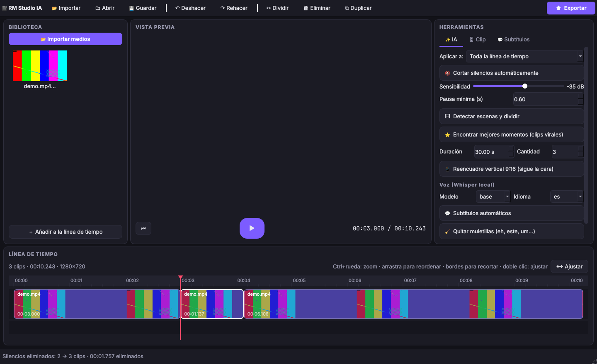

# 🎬 RM Studio IA

Editor de video de escritorio con **inteligencia artificial 100 % local**: sin nube, sin API,
**sin tokens y sin costes por uso**. Pensado para editar videos completos y crear clips cortos
(Shorts, Reels, TikTok) en segundos.



## ✨ Funciones

### Edición
- Biblioteca de medios con miniaturas (arrastra y suelta archivos en la ventana).
- Vista previa en tiempo real de la línea de tiempo (sin renderizar).
- Línea de tiempo: dividir (`S`), recortar arrastrando los bordes, reordenar arrastrando, duplicar, eliminar, zoom (`Ctrl + rueda`).
- Velocidad (0.25×–4×) y volumen por clip.
- Editor de subtítulos (editar texto, añadir, quitar).
- Deshacer / rehacer ilimitado (100 pasos), guardar/abrir proyectos `.rmproj`.
- Exportar a MP4 (H.264 + AAC) con presets: YouTube 1080p, 720p, 4K, 9:16, 1:1, 4:5.
  Encuadre: barras negras, recorte o **fondo desenfocado**.

### IA local (0 tokens)
| Función | Cómo funciona | Coste |
|---|---|---|
| 🔇 Cortar silencios | Análisis de audio con FFmpeg `silencedetect` | Segundos, CPU |
| 🎞 Detectar escenas | Diferencia entre fotogramas a 160 px de ancho | Muy rápido |
| ⭐ Mejores momentos | Energía de audio + picos + densidad de voz + cambios de escena (numpy) | Segundos |
| 📱 Reencuadre 9:16 | Detección de caras con OpenCV (pocos fotogramas) | Muy rápido |
| 💬 Subtítulos automáticos | Whisper **local** (`faster-whisper`, int8 en CPU) | Gratis, sin internet tras la 1.ª descarga |
| 🧹 Quitar muletillas | Marcas de tiempo por palabra de Whisper ("eh", "este", "um"…) | Gratis |

Con **⭐ Mejores momentos** puedes exportar directamente varios clips verticales con la cara
centrada y subtítulos incrustados, o abrirlos en la línea de tiempo para retocarlos.

## 🚀 Instalación

1. Instala **Python 3.10+** y **FFmpeg** (debe estar en el `PATH`):
   - Windows: `winget install Gyan.FFmpeg`
   - macOS: `brew install ffmpeg`
   - Linux: `sudo apt install ffmpeg`
2. Ejecuta:
   - **Windows:** doble clic en `run.bat`
   - **Linux / macOS:** `./run.sh`

   La primera vez se crea un entorno virtual y se instalan las dependencias.

Instalación manual:
```bash
pip install -r requirements.txt
python -m rmstudio            # o: python -m rmstudio video.mp4
```

`faster-whisper` y `opencv` son opcionales: sin ellos la app funciona y sólo se desactivan
los subtítulos/muletillas y el seguimiento de cara. El modelo de Whisper (`tiny` 75 MB,
`base` 145 MB, `small` 480 MB) se descarga una sola vez y queda en caché.

## ⌨️ Atajos

| Tecla | Acción |
|---|---|
| `Espacio` | Reproducir / pausar |
| `S` | Dividir en el cursor |
| `Supr` | Eliminar clip |
| `Ctrl+D` | Duplicar clip |
| `←` / `→` | Fotograma anterior / siguiente |
| `J` / `L` | −5 s / +5 s |
| `Ctrl+Z` / `Ctrl+Y` | Deshacer / rehacer |
| `Ctrl+I` / `Ctrl+S` / `Ctrl+O` | Importar / guardar / abrir |

## ⚡ Por qué es ligero
- La vista previa reproduce los archivos originales; nada se renderiza hasta exportar.
- La exportación es **un único comando FFmpeg** (sin archivos intermedios).
- Los análisis trabajan sobre audio a 8–16 kHz y video reducido.
- Todas las tareas pesadas corren en segundo plano y se pueden cancelar.

## 🧱 Estructura
```
rmstudio/
  core/   ffmpeg_utils.py · project.py (modelo + deshacer) · exporter.py
  ai/     silence.py · scenes.py · highlights.py · reframe.py · transcribe.py
  ui/     main_window.py · timeline.py · player.py · dialogs.py · theme.py · workers.py
tests/    pruebas del núcleo y de la IA (pytest)
```

## 📦 Crear un ejecutable (opcional)
```bash
pip install pyinstaller
pyinstaller --name "RM Studio IA" --windowed -p . rmstudio/__main__.py
```

## 🧪 Pruebas
```bash
pip install pytest && python -m pytest
```
